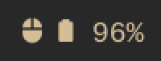
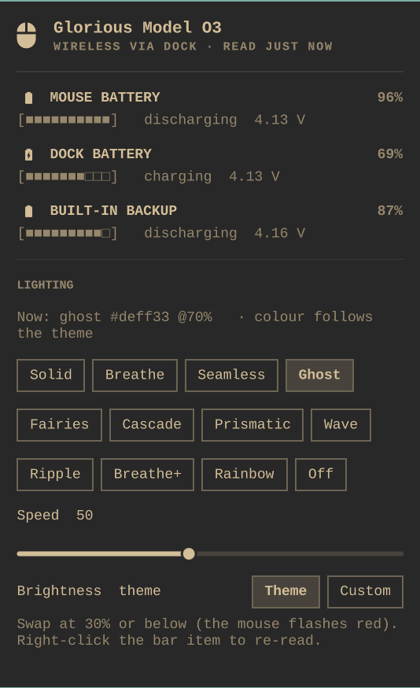

# Glorious Mouse for Omarchy

An [Omarchy](https://omarchy.org) bar widget for the **Glorious Model O3 Wireless**: battery for the
mouse, its swap pack and the charging dock, plus lighting that follows your Omarchy theme.

<p>
<br><br>

</p>

- **Bar:** the mouse battery %, red at 30% or below, dimmed while the mouse sleeps.
- **Click for the panel:** shows the battery levels, the dock's own battery and whether it's
  charging, and how the mouse is connected (dock or cable).
- **Lighting:** pick from 12 effects, plus speed and brightness. The colour comes from the
  current theme (its `keyboard.rgb`, else its accent) and is re-applied on every
  `omarchy theme set`. The DPI-stage LEDs get the theme's neighbouring hues.

It talks to the mouse through [glorious-linux](https://github.com/Virel0/glorious-linux). Nothing
here needs root.

## Install

1. Install **glorious-linux**. It asks once for sudo, to install its udev rule:

   ```sh
   curl -fsSL https://raw.githubusercontent.com/Virel0/glorious-linux/main/install.sh | bash
   ```

   Unplug and replug the dock afterwards.

2. Install the widget:

   ```sh
   curl -fsSL https://raw.githubusercontent.com/mattvv/omarchy-glorious-mouse/main/install.sh | bash
   ```

   Or from a clone: `git clone https://github.com/mattvv/omarchy-glorious-mouse && cd omarchy-glorious-mouse && ./install.sh`

`install.sh` does four things:

- It checks that glorious-linux and its udev rule are installed.
- It runs `omarchy plugin add … --enable`.
- It installs a `theme-set` hook and a `post-boot` hook, which re-apply the lighting.
- It applies the lighting once.

Two options:

- `./install.sh --no-hooks` skips the hooks.
- `./install.sh --uninstall` removes the plugin and the hooks.

**Plugin only:** `omarchy plugin add https://github.com/mattvv/omarchy-glorious-mouse.git --enable`
(no hooks, so the lighting won't change with the theme).

Updates: `omarchy plugin update io.github.mattvv.glorious-mouse`.

## Firmware note (O3)

O3s shipped with mouse firmware **1.0.1** ignore every lighting effect except `off`. The battery
readout works on any firmware.

To update to 1.3.3 or later:

1. Put the mouse on its USB cable.
2. Run `glorious mouse firmware flash --part mouse`.
3. Power-cycle the mouse: hold the power button for 3 s.

## Command line

The panel uses `glorious-mouse-lighting`, which is in the plugin folder
(`~/.config/omarchy/plugins/io.github.mattvv.glorious-mouse/`):

```sh
glorious-mouse-lighting show                      # what would be sent for the current theme
glorious-mouse-lighting set --effect wave --speed 70
glorious-mouse-lighting set --brightness theme    # or 0-100
glorious-mouse-lighting apply                     # re-apply (what the hooks run)
```

Your choice is saved in `~/.local/state/glorious-mouse/lighting.json`.

## Notes

- The mouse's lighting command takes a **single colour**. Effects like wave, cascade and ripple
  animate that colour. Rainbow and prismatic use the mouse's own palette.
- The O3 reports two batteries:
  - **Block 1** is the swappable InfinitePlay pack. This is the headline number on the bar.
  - **Block 2** is the cell built into the mouse.
- The dock battery is read from the receiver (command `0xE2`), so it only shows when the dock is
  plugged into this PC.
- Reads happen every 2 minutes. A sleeping mouse doesn't answer, so its last reading stays,
  dimmed. Right-click the bar item to re-read it now.
- Tested on an O3 Wireless (firmware 1.3.3, dock 1.0.0). The D3 Wireless uses the same protocol
  and should work, but it hasn't been tested.

## License

MIT. Unofficial: not affiliated with Glorious.
